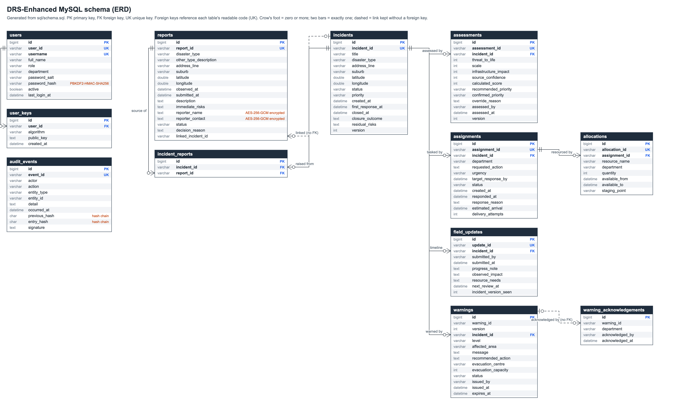

# DRS-Enhanced ERD



The ERD is **generated from `sql/schema.sql`**, which is itself generated
from `MySqlSchema`, so it always matches the database the server creates.

| File | What it is |
|---|---|
| `drs-erd.png` | The ERD for the report (rendered from the SVG at 2x) |
| `drs-erd.svg` | The same ERD as a vector image |
| `drs-erd.mmd` | Mermaid source; GitHub draws it below |
| `generate_erd.py` | Reads `sql/schema.sql` and writes the `.mmd` and `.svg` |

## Reading it

- **12 tables, 8 foreign keys.** Every table has a `BIGINT AUTO_INCREMENT`
  primary key `id` (spec 2.4) and keeps its readable code (`INC-0001`) as a
  unique key (UK). Foreign keys reference those codes.
- **Cardinality:** every foreign-key column is `NOT NULL`, so each child row
  has exactly one parent (two bars) and a parent has zero or more children
  (circle and crow's foot).
- `incident_reports` resolves the many-to-many link between incidents and
  the public reports they were raised from.
- **Dashed links have no foreign key, on purpose:**
  `reports.linked_incident_id` (the link table already enforces it, and a
  key both ways would make reports and incidents depend on each other), and
  `warning_acknowledgements.warning_id` (a warning's code is shared by all
  its versions, so it is not a unique key).
- Orange notes mark the columns protected by the security measures (see
  `docs/security/security-design.md`).

## Regenerate after a schema change

```
java -cp build/classes au.edu.cqu.drs.repository.mysql.MySqlSchema > sql/schema.sql
python3 docs/erd/generate_erd.py
"/Applications/Google Chrome.app/Contents/MacOS/Google Chrome" --headless=new --hide-scrollbars --force-device-scale-factor=2 --window-size=2015,1183 --screenshot=docs/erd/drs-erd.png docs/erd/drs-erd.svg
```

The window size is the `width` and `height` at the top of `drs-erd.svg`.
Any browser can also open the SVG and save or print it.

## Mermaid version

```mermaid
erDiagram
    direction LR
    users {
        bigint id PK
        varchar user_id UK
        varchar username UK
        varchar full_name
        varchar role
        varchar department
        varchar password_salt
        varchar password_hash "PBKDF2-HMAC-SHA256"
        boolean active
        datetime last_login_at
    }
    reports {
        bigint id PK
        varchar report_id UK
        varchar disaster_type
        varchar other_type_description
        varchar address_line
        varchar suburb
        double latitude
        double longitude
        datetime observed_at
        datetime submitted_at
        text description
        text immediate_risks
        text reporter_name "AES-256-GCM encrypted"
        text reporter_contact "AES-256-GCM encrypted"
        varchar status
        text decision_reason
        varchar linked_incident_id
    }
    incidents {
        bigint id PK
        varchar incident_id UK
        varchar title
        varchar disaster_type
        varchar address_line
        varchar suburb
        double latitude
        double longitude
        varchar status
        varchar priority
        datetime created_at
        datetime first_response_at
        datetime closed_at
        text closure_outcome
        text residual_risks
        int version
    }
    incident_reports {
        bigint id PK
        varchar incident_id FK
        varchar report_id FK
    }
    assessments {
        bigint id PK
        varchar assessment_id UK
        varchar incident_id FK
        int threat_to_life
        int scale
        int infrastructure_impact
        int source_confidence
        int calculated_score
        varchar recommended_priority
        varchar confirmed_priority
        text override_reason
        varchar assessed_by
        datetime assessed_at
        int version
    }
    assignments {
        bigint id PK
        varchar assignment_id UK
        varchar incident_id FK
        varchar department
        text requested_action
        varchar urgency
        datetime target_response_by
        varchar status
        datetime created_at
        datetime responded_at
        text response_reason
        datetime estimated_arrival
        int delivery_attempts
    }
    allocations {
        bigint id PK
        varchar allocation_id UK
        varchar assignment_id FK
        varchar resource_name
        varchar department
        int quantity
        datetime available_from
        datetime available_to
        varchar staging_point
    }
    field_updates {
        bigint id PK
        varchar update_id UK
        varchar incident_id FK
        varchar submitted_by
        datetime submitted_at
        text progress_note
        text observed_impact
        text resource_needs
        datetime next_review_at
        int incident_version_seen
    }
    audit_events {
        bigint id PK
        varchar event_id UK
        varchar actor
        varchar action
        varchar entity_type
        varchar entity_id
        text detail
        datetime occurred_at
        char previous_hash "hash chain"
        char entry_hash "hash chain"
        text signature
    }
    warnings {
        bigint id PK
        varchar warning_id
        int version
        varchar incident_id FK
        varchar level
        varchar affected_area
        text message
        text recommended_action
        varchar evacuation_centre
        int evacuation_capacity
        varchar status
        varchar issued_by
        datetime issued_at
        datetime expires_at
    }
    warning_acknowledgements {
        bigint id PK
        varchar warning_id
        varchar department
        varchar acknowledged_by
        datetime acknowledged_at
    }
    user_keys {
        bigint id PK
        varchar user_id FK
        varchar algorithm
        text public_key
        datetime created_at
    }
    incidents ||--o{ incident_reports : "raised from"
    reports ||--o{ incident_reports : "source of"
    incidents ||--o{ assessments : "assessed by"
    incidents ||--o{ assignments : "tasked by"
    assignments ||--o{ allocations : "resourced by"
    incidents ||--o{ field_updates : "timeline"
    incidents ||--o{ warnings : "warned by"
    users ||--o{ user_keys : "signs with"
    incidents |o..o{ reports : "linked (no FK)"
    warnings |o..o{ warning_acknowledgements : "acknowledged by (no FK)"
```


